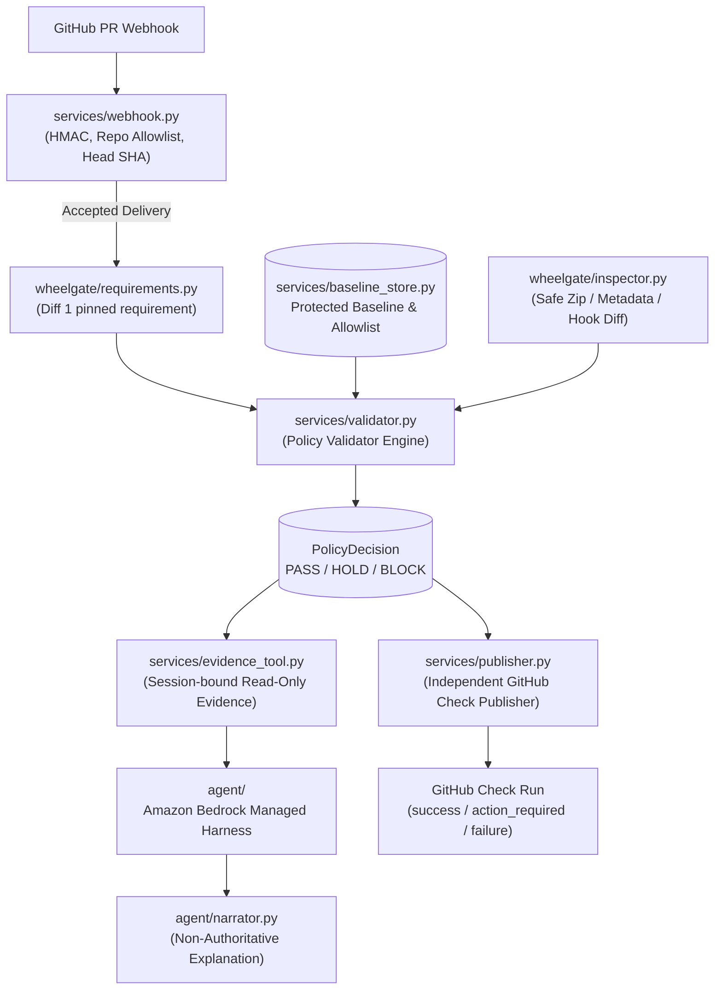

# WheelGate X — Architecture & System Design

## 1. Architectural Topology

## 2. Core Subsystems

### 2.1 Webhook Intake (`services/webhook.py` — FR-01)
- Verifies `X-Hub-Signature-256` HMAC using timing-safe comparison (`hmac.compare_digest`).
- Enforces repository ID allowlist to prevent unauthorized tenant requests.
- Accepts `pull_request` events for `opened`, `synchronize`, and `reopened` actions.
- Binds request to `X-GitHub-Delivery` ID and commit `head_sha`.

### 2.2 Requirement Delta Parser (`wheelgate/requirements.py` — FR-02)
- Enforces that exactly **one** pinned requirement line changes from `pkg==old` to `pkg==new`.
- Rejects multi-line updates, unpinned specs (`>=`, `~=`), flags (`-r`, `-e`, `-i`), environment markers (`;`), and direct URLs/VCS with reason codes (`MULTIPLE_REQUIREMENTS_CHANGED`, `UNSUPPORTED_REQUIREMENT_SYNTAX`).

### 2.3 Wheel & Startup Hook Inspector (`wheelgate/inspector.py` — FR-05, FR-06, FR-07, FR-19)
- **Static non-executing inspection:** Uses standard library `zipfile` with strict size, entry, and expansion ratio limits. Never imports or installs package code.
- **Wheel Metadata Validation (FR-07):** Validates existence and format of `.dist-info/WHEEL` and `.dist-info/METADATA`. Checks that `Name` and `Version` match the wheel filename.
- **RECORD Member Digest Verification (FR-19):** Computes SHA-256 and byte sizes of all archive members and verifies them against `.dist-info/RECORD`.
- **Differential Startup-Hook Analysis (FR-06):** Differentiates Python 3.12/3.13 executable `.pth` lines (`import ` or `import\t`) from path-only lines. Compares candidate hooks against approved baseline by normalized installed path + exact SHA-256.

### 2.4 Protected Baseline & Policy Store (`services/baseline_store.py` — FR-08)
- Stores approved baselines and allowlisted startup hooks.
- Accessible only by backend services; isolated from LLM context and pull request text.

### 2.5 Authoritative Policy Validator (`services/validator.py` — FR-09)
- Orchestrates deterministic evaluation following the frozen PRD v2.0 Section 7.3 algorithm.
- Outputs machine-verifiable `PolicyDecision` containing reason codes and `HookDiff` records.

### 2.6 AgentCore Managed Harness (`agent/` — FR-10, FR-11)
- Configured with strict `allowedTools: ["get_current_assessment_evidence"]`.
- Direct command APIs (`InvokeAgentRuntimeCommand`, shell execution) and secrets access are explicitly denied via IAM and harness config.
- Produces structured, non-authoritative explanations (`AgentNarrative`).

### 2.7 Independent Check Publisher (`services/publisher.py` — FR-13)
- Maps validator decisions:
  - `PASS` -> `conclusion: success`
  - `HOLD` -> `conclusion: action_required`
  - `BLOCK` -> `conclusion: failure`
- Enforces publication invariant: verifies that `decision.head_sha == current_github_head_sha` before publishing.
